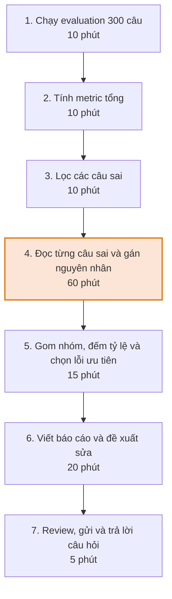
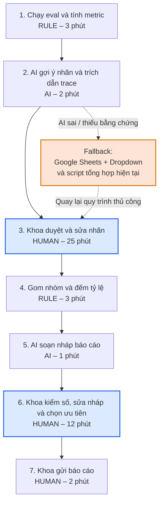

# Báo cáo nhóm — Day 02 Discovery & Problem Framing

> Bản chung của nhóm, viết trên repo do nhóm trưởng fork. Không copy file này sang repo cá nhân.
> Template chi tiết và prompt mẫu: [docs/01-worksheet.md](../../docs/01-worksheet.md). Bài mẫu: [docs/02-deliverable-example.md](../../docs/02-deliverable-example.md).

## 1. Thông tin nhóm

- Tên nhóm:
- Thành viên: xem `TEAM.md`
- Candidate problem được chọn (1 câu):
- Quyết định cuối: Go / Not Yet / No-Go

---

## 2. Hội tụ nhóm (CP3)

### 2.1. Pitch

| # | Người đưa ra | Candidate (Job Story ngắn) | Actor | Bottleneck | Câu hỏi phản biện nhận được (ai hỏi) |
|---:|---|---|---|---|---|
| 1 | Bảo | Khi cần một con số từ database, tôi muốn hỏi bằng ngôn ngữ tự nhiên, để không phải chờ team data | Nhân viên marketing, không biết SQL | Chờ analyst nhận việc và hỏi đi hỏi lại 2–3 câu làm rõ: trung bình 2 ngày từ lúc gửi yêu cầu tới lúc nhận số, trong khi analyst chỉ mất 10–15 phút để viết query | "Nếu AI viết sai query mà người dùng không biết SQL để kiểm tra thì sao? Số sai còn tệ hơn chờ 2 ngày." (Ly) |
| 2 | Bảo | Khi có hàng trăm bình luận và tin nhắn về sản phẩm, tôi muốn biết khách đang khen và phàn nàn điều gì, để điều chỉnh nội dung và báo lại cho team sản phẩm | Nhân viên marketing phụ trách fanpage và quảng cáo | Đọc và gắn nhãn khen/chê bằng tay: 300+ bình luận/tuần, khoảng 90 phút, dễ bỏ sót hoặc gắn nhãn không nhất quán giữa các tuần | "Công cụ social listening có sẵn đã phân loại cảm xúc rồi, sao phải tự xây?" (Hưng) |
| 3 | Bảo | Khi quản lý duyệt nội dung, họ muốn thấy bản nháp đã đúng quy tắc thương hiệu, để không phải sửa cùng một lỗi nhiều lần | Nhân viên marketing (người viết), quản lý marketing (người duyệt) | Vòng duyệt lặp lại: 40% bài bị trả lại vì sai tone hoặc thiếu thông tin bắt buộc, mỗi lần trả lại mất thêm nửa ngày và làm trễ lịch đăng | "Một checklist quy tắc thương hiệu dài 1 trang có giải quyết được không? Tại sao cần AI?" (Anh) |
| 4 |Hưng |Khi xong eval hằng tuần, tôi muốn biết các câu sai hỏng vì nguyên nhân gì, để báo cáo và chọn việc sửa trước planning |Junior AI Engineer phụ trách đánh giá RAG |Đọc và gán nhãn khoảng 60 câu sai (60/130 phút), nhãn lệch giữa các lần gán |“Chỉ xem metric tổng thì có đủ không?”(Bảo) |
| 5 |Hưng |Khi support báo bot trả lời sai, tôi muốn tái hiện lỗi nhanh, để giải thích cho khách |Kỹ sư AI nhận ticket từ support |Tìm đúng trace và tài liệu nguồn: 15 phút/lần, 4 lần/tuần |“Log hiện tại có lưu đủ trace và đoạn tài liệu truy xuất để tái hiện lỗi không?”(Ly) |
| 6 |Hưng |Khi cần mở rộng bộ eval, tôi muốn có sẵn cặp câu hỏi và đáp án từ ticket, để eval sát thực tế |Kỹ sư AI |Viết lại câu hỏi và đáp án chuẩn, ẩn dữ liệu cá nhân: khoảng 3 giờ/lần |“Ticket có thông tin khách hàng, bạn được phép dùng chưa?”(Anh) |
| 7 |Việt Anh |Khi bắt đầu làm việc trên một project có nhiều module và file code, tôi muốn nhanh chóng hiểu cấu trúc project và luồng xử lý giữa các thành phần, để có thể bắt đầu implement feature mà không phải đọc lại quá nhiều code. |Software Developer, AI Engineer mới tiếp nhận project |Phải đọc nhiều file code, tìm hiểu quan hệ giữa các module và lần theo luồng xử lý để xác định vị trí cần thay đổi |Làm thế nào để xác định những module và file code thực sự liên quan đến feature cần implement mà không phải đọc toàn bộ project? (Hưng) |
| 8 |Việt Anh |Khi thực hiện nhiều thí nghiệm huấn luyện mô hình với các cấu hình khác nhau, tôi muốn tổng hợp và so sánh kết quả của các lần chạy trong cùng một nơi, để xác định mô hình và cấu hình phù hợp nhất |ML Engineer, AI Researcher |Metrics, log, checkpoint và cấu hình của các lần chạy nằm ở nhiều nơi, khiến việc tổng hợp, đối chiếu và so sánh kết quả mất thời gian |Nếu chuẩn hóa việc lưu metrics và sử dụng dashboard để so sánh thì đã giải quyết được vấn đề chưa, hay thực sự cần AI phân tích kết quả experiment? (Ly) |
| 9 |Việt Anh |Khi một thành viên mới tham gia project, tôi muốn họ có thể tự tìm hiểu cấu trúc và quy trình làm việc của project, để không phải liên tục hỏi các thành viên cũ về những thông tin cơ bản |Thành viên mới, Mentor, Team Leader |Kiến thức về cấu trúc project, tài liệu hướng dẫn và quy trình làm việc phân tán hoặc chưa được tài liệu hóa đầy đủ, khiến thành viên mới phải hỏi lại người cũ nhiều lần |Làm thế nào để xác định thành viên mới đã hiểu đủ về project để tự làm việc? Có thể giải quyết bằng cách chuẩn hóa tài liệu onboarding thay vì sử dụng AI không? (Bảo) |
| 10 |Ly |Khi thực hiện nghiên cứu, tôi muốn hệ thống hóa và so sánh các phương pháp từ nhiều paper để lựa chọn hướng tiếp cận phù hợp |Sinh viên, nhà nghiên cứu |Khó đối chiếu phương pháp do paper sử dụng cấu trúc và tiêu chí đánh giá khác nhau |Bạn dựa trên những tiêu chí nào để so sánh các phương pháp nghiên cứu?(Bảo) |
| 11 | Ly|Khi đề xuất nghiên cứu mới, tôi muốn xác định những hạn chế và vấn đề chưa được giải quyết để tìm ra Research Gap có cơ sở khoa học |Sinh viên, nghiên cứu viên |Khó tổng hợp hạn chế từ nhiều nghiên cứu và chứng minh tính mới của khoảng trống |Làm thế nào để xác định một Research Gap thực sự tồn tại chứ không chỉ là vấn đề bạn chưa tìm thấy trong các paper đã đọc?(Hưng)|
| 12 | Ly| Khi thực hiện nghiên cứu dài hạn, tôi muốn quản lý các phiên bản tài liệu, mã nguồn và kết quả để tránh nhầm lẫn|Sinh viên, nhóm nghiên cứu |Khó truy xuất phiên bản và liên kết kết quả với cấu hình tương ứng |Bạn đã từng gặp trường hợp không xác định được checkpoint tương ứng với cấu hình huấn luyện nào chưa? (Anh)|

### 2.2. Cluster

| Cluster | Các candidate | Pattern chung |
|---|---|---|
| A | #2, #4, #6 | Phân loại và gắn nhãn văn bản hàng loạt |
| B | #5, #7, #9 | Tìm kiếm và nắm ngữ cảnh trong tri thức hoặc code phân tán |
| C | #8, #10, #11, #12 | Tổng hợp và đối chiếu nhiều nguồn hoặc nhiều lần chạy để ra quyết định |
| D | #1, #3 | Giảm vòng chờ và kiểm tra lặp lại giữa người không chuyên và người chuyên môn |

### 2.3. Opportunity Solution Tree rút gọn

Gốc là **1 outcome**. Nhánh là **opportunity** (nhu cầu, pain), không phải tính năng hay công cụ.

```text
OUTCOME: Giảm thời gian người vận hành dành cho đọc và gán nhãn văn bản mỗi tuần, mà vẫn giữ nhãn nhất quán và không bỏ sót nguyên nhân hay chủ đề chính
├── Opportunity A: Phải đọc và gán nhãn thủ công khối lượng văn bản lớn mỗi tuần (~60 câu sai RAG, 300+ bình luận)
├── Opportunity B: Nhãn không nhất quán giữa các tuần và giữa các lần gán, khiến kết quả khó so sánh
└── Opportunity C: Chưa rõ kết quả phân loại có thực sự được dùng để chọn việc sửa hoặc báo lại cho team khác không
```

Những ý đã gạch bỏ vì là solution đội lốt opportunity:
- Dashboard tự động phân loại lỗi (là công cụ, không phải nhu cầu).
- Agent tự sửa prompt sau khi phân loại (là giải pháp, vượt quá phạm vi pain).
- Dùng công cụ social listening có sẵn (là công cụ cụ thể, không phải nhu cầu).
- "Hỏi database bằng ngôn ngữ tự nhiên" (#1) và "kiểm tra bản nháp bằng AI" (#3) khi viết ở dạng này. Pain thật bên dưới là *chờ người chuyên môn* và *vòng duyệt lặp lại*, thuộc cụm D chứ không thuộc outcome này.

### 2.4. Chấm điểm shortlist (1–5)

Shortlist lấy từ cụm có bottleneck rõ và có số liệu nhất (cụm A và D): **#4, #2, #1**.

| Candidate | Actor rõ | Quy trình rõ | Pain có bằng chứng | Impact đo được | Vừa sức lab | So sánh được No AI/Rule/Workflow/Agent | Nhóm hiểu domain | Tổng |
|---|---:|---:|---:|---:|---:|---:|---:|---:|
| #4 Phân loại nguyên nhân câu sai sau eval RAG hằng tuần | 5 | 5 | 4 | 5 | 4 | 5 | 5 | 33 |
| #2 Phân tích khen/chê từ bình luận, tin nhắn | 5 | 4 | 4 | 4 | 4 | 4 | 3 | 28 |
| #1 Hỏi database bằng ngôn ngữ tự nhiên | 4 | 4 | 4 | 4 | 3 | 4 | 2 | 25 |

**Candidate được chọn:** #4, phân loại nguyên nhân các câu sai sau eval RAG hằng tuần

**Vì sao chọn:**
- Actor (Junior AI Engineer phụ trách đánh giá RAG) và quy trình (eval hằng tuần, gán nhãn, báo cáo, chọn việc sửa trước planning) đều rõ.
- Pain có số liệu: khoảng 60 câu sai mỗi lần, khoảng 60/130 phút, nhãn lệch giữa các lần gán.
- Impact đo được trực tiếp bằng thời gian gán nhãn và độ nhất quán nhãn.
- Dễ dựng đủ 4 mức để so sánh: không dùng AI (gán tay), rule (từ khóa, metric), workflow (LLM gán nhãn theo bảng nguyên nhân cố định), agent.
- Nhóm hiểu domain vì Hưng là người trực tiếp làm việc này.
- Phản biện "chỉ xem metric tổng có đủ không?" (Bảo) có thể trả lời bằng chính baseline *rule*: metric tổng cho biết sai bao nhiêu, nhưng không cho biết sai vì đâu.

**Vì sao loại các candidate còn lại:**
- **#2 (khen/chê bình luận):** pain có thật nhưng công cụ social listening đã phân loại cảm xúc (phản biện của Hưng), nên khó chứng minh giá trị tăng thêm. Nhóm cũng hiểu domain marketing yếu hơn.
- **#1 (hỏi database):** giá trị lớn nhưng rủi ro "số sai mà người dùng không biết" (phản biện của Ly) đòi hỏi cơ chế kiểm chứng riêng. Ngoài ra còn cần quyền truy cập schema và dữ liệu, khó vừa sức lab.
- **Cụm B (#5, #7, #9):** phụ thuộc chất lượng log và tài liệu hiện có, chưa chắc đủ dữ liệu để tái hiện lỗi; #9 có thể giải quyết bằng chuẩn hóa tài liệu onboarding.
- **Cụm C (#8, #10, #11, #12):** chưa có số liệu bottleneck rõ, nhiều nhu cầu giải quyết được bằng chuẩn hóa lưu trữ hoặc dashboard mà không cần AI.
- **#3 (quy tắc thương hiệu):** phản biện "checklist 1 trang có đủ không?" (Việt Anh) chưa được trả lời, nhiều khả năng giải pháp No AI/Rule đã đủ.
- **#6 (tạo eval set từ ticket):** ticket chứa thông tin khách hàng, nhóm chưa rõ quyền sử dụng và dễ trượt thành dự án xử lý dữ liệu cá nhân quá lớn cho thời gian của lab.

**Xử lý bất đồng (nếu có):** Chưa ghi nhận bất đồng nào ở bước này. Nếu nhóm có ý kiến khác (ví dụ ai đó muốn chọn #1 hoặc #2), sẽ ghi lại ý kiến, lý do, và cách nhóm thống nhất (ví dụ đưa vào mục hướng tiếp theo vì chưa có baseline đo được).

---

## 3. Kiểm chứng + research giải pháp đã có (CP4)

### 3.1. Assumption Map

| # | Giả định | Loại (Value / Usability / Feasibility / Viability) | Quan trọng (1–5) | Đã có bằng chứng (1–5) | Kiểm chứng trước? |
|---:|---|---|---:|---:|---|
| 1 |Kỹ sư khác cũng mất trên 60 phút/tuần để phân tích lỗi eval| Value |5 |2 |Có |
| 2 |Bước tốn nhất là đọc và gán nhãn từng câu sai, không phải chạy eval |Value |5 |2 |Có |
| 3 |Danh sách nguyên nhân lỗi đủ ổn định giữa các tuần để AI gán nhãn theo danh sách cố định  |Value |4 |1 |có|
| 4 |LLM gán nhãn trùng với người từ 80% trở lên |Feasibility |5 |1 |Có (thí nghiệm 40 câu) |
| 5 |Kết quả eval xuất được ra JSON để đưa vào script |Feasibility |4 |4 |Không |
| 6 |Công ty cho phép gửi nội dung câu hỏi và tài liệu nội bộ vào API LLM bên ngoài |Viability |5 |2 | Hỏi Tech Lead sau lab |

Giả định nhóm kiểm chứng trong buổi này:

### 3.2. Kiểm chứng
Nhóm phỏng vấn 3 kỹ sư AI/ML quen biết (theo The Mom Test), làm poll 6 người trong lớp, và chạy một thí nghiệm nhỏ để kiểm giả định #4. **Dữ liệu phỏng vấn, poll và thí nghiệm dưới đây là hư cấu để minh họa.**

| Trường | Nội dung |
|---|---|
| Người được hỏi (vai trò, không ghi tên thật) |ML Engineer, công ty thương mại điện tử khoảng 300 người |
| Câu nói đáng nhớ nhất (nguyên văn) |"Chạy eval thì máy làm. Cái mình ngồi lâu là đọc từng câu sai rồi đoán lỗi nằm ở retrieval hay ở prompt."|
| Lần gần nhất gặp vấn đề này: chuyện gì đã xảy ra? |Thứ Năm tuần trước, sau khi đổi embedding model, đọc 80 câu sai mất khoảng 1,5 giờ |
| Hiện đang xử lý bằng cách nào (workaround)? |Google Sheets có cột nhãn, nhưng hay quên định nghĩa của từng nhãn |
| Mất bao lâu, bao lần? |1–2 lần/tuần sau mỗi thay đổi lớn |
| Insight / opportunity rút ra |Pain nằm ở việc đọc và gán nhãn, và định nghĩa nhãn bị trôi theo thời gian |

Tổng hợp:

| Nguồn | Số người / số mẫu | Tín hiệu xác nhận | Tín hiệu phản bác |
|---|---:|---|---|
| Phỏng vấn | 3 | 2/3 mất nhiều thời gian nhất ở việc đọc và gán nhãn câu sai | 1 người nói chỉ cần nhìn metric tổng (faithfulness, recall) để quyết định, không đọc từng câu |
| Poll trong lớp | 6 | 4/6 từng phân tích lỗi mô hình hoặc RAG thủ công hơn 1 giờ | 2/6 nói metric tổng là đủ |
| Thí nghiệm gán nhãn (LLM so với Khoa) | 40 + 40 câu sai | Với danh sách nhãn ban đầu, trùng 29/40 (72,5%). Sau khi thêm định nghĩa và 2 ví dụ cho mỗi nhãn, trùng 34/40 (85%) trên 40 câu mới | 11/40 câu lệch nhãn ở lần đầu, hay lẫn giữa "retrieval bỏ sót" và "tài liệu nguồn thiếu"; 15% vẫn sai sau khi chỉnh |

**Nhóm đã sửa problem thế nào sau kiểm chứng:**thu hẹp từ "tự động hóa error analysis" thành "**gợi ý nhãn nguyên nhân theo danh sách cố định và soạn nháp báo cáo, người duyệt từng nhãn**". Thí nghiệm cho thấy 85% đủ để làm gợi ý nhưng chưa đủ để thay người. Thêm phương án không dùng AI cho team chỉ cần metric tổng. Giả định #3 (danh sách nhãn ổn định) vẫn chưa đủ bằng chứng.

### 3.3. Research giải pháp đã có

| Công cụ / case / pattern | Link | Giải bước nào trong quy trình? | Điểm mạnh | Khoảng trống / rủi ro | Bài học cho nhóm |
|---|---|---|---|---|---|
| Langfuse: annotation queues và LLM-as-a-Judge|(https://langfuse.com/docs/evaluation/evaluation-methods/annotation-queues), cùng [hướng dẫn error analysis](https://langfuse.com/blog/2025-08-29-error-analysis-to-evaluate-llm-applications) | Bước 3–5: duyệt và gán nhãn câu sai, gom nhóm, theo dõi bằng score | Có hàng đợi để duyệt trace; ghi chú tự do trước rồi gom thành nhóm lỗi ổn định. Bản tháng 8/2025 của hướng dẫn gợi ý bắt đầu với 50–100 trace đa dạng (trang hiện tại chỉ nói cần mẫu đại diện, không nêu số). Trang annotation queue nói dùng nhãn của người để căn chỉnh LLM judge | Phải đưa dữ liệu vào dưới dạng trace hoặc dataset (Khoa đang dùng JSONL, tốn công chuyển). Judge nên dựa trên nhóm lỗi đã biết, nên vẫn cần bước đọc dữ liệu trước | Danh sách nhãn phải rút ra từ việc đọc dữ liệu thật trước. LLM chỉ nên gán nhãn theo danh sách đó và phải đối chiếu với nhãn người |
| LangSmith Insights Agent |(https://docs.langchain.com/langsmith/insights) | Bước 4–5: tự gom trace thành nhóm failure mode, không cần định nghĩa trước | Phát hiện nhóm lỗi chưa biết và xuất báo cáo theo cụm; có thể lọc theo tín hiệu như phản hồi xấu của người dùng ([thông báo 10/2025](https://blog.langchain.com/insights-agent-multiturn-evals-langsmith)) | Khi công bố chỉ có cho gói Plus và Enterprise cloud, cần kiểm lại gói hiện tại. Một blog của đối thủ ([Latitude](https://latitude.so/blog/langsmith-alternatives-agent-observability-2026)) nhận xét chưa có vòng đời issue và theo dõi tần suất; đọc dè dặt vì họ cạnh tranh | Hữu ích để khám phá nhóm lỗi mới, nhưng phụ thuộc gói trả phí và dữ liệu phải nằm trong LangSmith. Không thay bước người duyệt |
| Arize Phoenix |(https://phoenix.arize.com) | Bước 3–4: tracing, evaluator, clustering embedding để cô lập chỗ kém | Mã nguồn mở, tự host, dựa trên OpenTelemetry, chạy được trong notebook | Giấy phép Elastic License 2.0 chứ không phải giấy phép OSI; mặc định xác thực tắt và lưu trace không giới hạn, trong khi trace chứa prompt và tài liệu truy xuất (theo [một radar công nghệ bên thứ ba](https://rubinlake.com/fr/technology-radar/data-platforms-and-mlops/arize-phoenix)) | Phù hợp nếu chính sách dữ liệu không cho gửi trace ra ngoài. Nhớ bật xác thực và đặt thời hạn lưu |
| Ragas |(https://docs.ragas.io) | Bước 2–3: tính metric Faithfulness, Response Relevancy, Context Precision, Context Recall (trang chủ tài liệu còn liệt kê Context Entities Recall và Noise Sensitivity) để lọc câu sai | Bộ metric phổ biến cho RAG, chạy được trong notebook hoặc batch | Cho biết điểm thấp, không nói nguyên nhân; context recall cần đáp án tham chiếu; mỗi metric gọi LLM nhiều lần mỗi mẫu, một nguồn bên thứ ba ước tính 100 mẫu cần khoảng 200–600 lần gọi API 
|(rhumb.dev|(https://rhumb.dev/service/ragas)) | Dùng cho bước tính metric (Rule). Bước nguyên nhân vẫn cần danh sách nhãn và người duyệt. Tính trước chi phí gọi API |

**Kết luận research:**

```text
Phần metric và log đã có công cụ. Phần "nguyên nhân lỗi" cần danh sách nhãn rút ra từ dữ liệu thật.
Hướng hợp lý: Rule tính metric → lọc câu sai → AI gợi ý nhãn theo danh sách cố định
→ Khoa duyệt từng nhãn → AI soạn nháp báo cáo → Khoa gửi.
Không tự xây nền tảng observability: pilot dùng Sheets và script; cần giao diện duyệt thì dùng Langfuse hoặc Phoenix.
```

Đây là điểm khác lớn nhất so với ý ban đầu của Khoa: lúc đầu Khoa định "xây công cụ tự động phân loại lỗi hoàn toàn và vẽ dashboard".
---

## 4. Quy trình trước/sau (CP5)

### 4.1. Quy trình hiện tại

Sơ đồ (ASCII, Mermaid hoặc link ảnh trong `report/assets/`):

```text

```

| Bước | Actor | Input | Output | Thời gian / tần suất | Ghi chú |
|---:|---|---|---|---|---|
| 1 | Khoa / Script | Dataset 300 câu, model và cấu hình evaluation | Kết quả evaluation | 10 phút/lần | Chạy và chờ xuất kết quả |
| 2 | Khoa | Kết quả evaluation | Các metric tổng hợp | 10 phút/lần | Tính bằng Sheets hoặc script rời |
| 3 | Khoa | Kết quả evaluation | Danh sách câu trả lời sai | 10 phút/lần | Lọc các trường hợp lỗi |
| 4 | Khoa | Câu sai, câu hỏi gốc, expected answer, actual answer, trace | Danh sách câu sai được gán nguyên nhân | 60 phút/lần | **Bottleneck chính** |
| 5 | Khoa | Danh sách lỗi đã gán nguyên nhân | Bảng nhóm lỗi, tỷ lệ và lỗi ưu tiên | 15 phút/lần | Tổng hợp thủ công |
| 6 | Khoa | Metrics và bảng thống kê lỗi | Báo cáo và đề xuất sửa | 20 phút/lần | Viết báo cáo thủ công |
| 7 | Khoa | Báo cáo dự thảo | Báo cáo hoàn chỉnh | 5 phút/lần | Review, gửi và trả lời câu hỏi |

**Bottleneck chính:** Bước 4 – Đọc từng câu trả lời sai và gán nguyên nhân, mất 60 phút, chiếm khoảng 46,15% tổng thời gian.

### 4.2. Quy trình tương lai

### Sơ đồ quy trình



### Boundary

- AI chỉ sử dụng dữ liệu được cung cấp.
- AI chỉ gợi ý nhãn thuộc danh sách nhãn cố định.
- AI phải trích dẫn bằng chứng từ trace gốc; không được tự tạo bằng chứng.
- AI không tự tính số liệu thống kê.
- AI không tự gửi báo cáo.
- AI không tự thay đổi prompt hoặc pipeline.
- Khoa có quyền chấp nhận, sửa hoặc từ chối mọi nhãn do AI đề xuất.

### Phương án quay về (Fallback)

Nếu AI gán nhãn sai nhiều, bằng chứng không hợp lệ hoặc chất lượng báo cáo không đạt yêu cầu:

1. Dừng sử dụng gợi ý AI.
2. Chuyển sang Google Sheets có dropdown để Khoa tự gán nhãn.
3. Sử dụng script hiện tại để tổng hợp số liệu.
4. Khoa tiếp tục viết và review báo cáo theo quy trình thủ công.

### 4.3. Before / after

| Chỉ số | Trước | Sau (kỳ vọng) | Ghi chú |
|---|---:|---:|---|
| Số bước |7 |7 | Không loại bỏ bước nghiệp vụ |
| Tổng thời gian |130 phút |48 phút |Giảm 82 phút, tương đương 63,08% |
| Số bước thủ công |7/7 |3/7 | Người trực tiếp làm chính ở bước 3, 6, 7 |
| Bottleneck chính |Gán nguyên nhân (60 phút) |Duyệt nhãn (25 phút) |Chuyển từ phân loại thủ công sang kiểm duyệt AI |
| Rủi ro mới phát sinh |Sai sót khi phân loại thủ công |AI gán nhãn sai, bằng chứng không hợp lệ, Khoa duyệt qua loa |Cần pilot và Blind Review |

---

  ## 5. Problem Statement v0 (CP5)
  
| Trường | Nội dung |
| --- | --- |
| **Actor** | Kỹ sư AI (junior) phụ trách đánh giá hệ thống RAG hằng tuần cho Tech Lead và PM |
| **Quy trình** | Mỗi chiều thứ Hai: chạy eval, tính metric, lọc câu sai, đọc và gán nhãn nguyên nhân, gom nhóm, viết báo cáo, review và gửi |
| **Bottleneck** | Đọc và gán nhãn khoảng 60 câu sai mất khoảng 60 phút, và nhãn không nhất quán giữa các lần gán |
| **Impact** | 130 phút/tuần/kỹ sư; 4/10 tuần gần nhất báo cáo đến sau planning; 6/20 câu gán lại ra nhãn khác, nên việc ưu tiên sửa có thể dựa trên nhãn lệch |
| **Success Metric** | Tổng thời gian từ 130 phút (bấm giờ 2 tuần) xuống dưới 60 phút, đo bằng tự ghi giờ 4 tuần pilot |
| **Boundary** | AI không tự sửa prompt hay pipeline, không tự gửi, không đặt nhãn ngoài danh sách, không thay người duyệt |

**Phản biện nhận được:** AI chỉ ra metric chỉ đo tốc độ. Báo cáo nhanh hơn nhưng nhãn sai thì nhóm sửa sai chỗ cả tuần. Nhóm đồng ý và thêm metric chất lượng ở v1.


-

---

## 6. Mức can thiệp AI (CP6)

### 6.1. Ma trận độ mơ hồ × độ phức tạp

Bài của nhóm nằm ở ô: Độ mơ hồ trung bình - Độ phức tạp trung bình

Vì sao:
- Độ mơ hồ trung bình vì đầu ra có phạm vi tương đối rõ: phân loại câu trả lời sai theo danh sách 8 nhãn nguyên nhân cố định. Tuy nhiên, một số nguyên nhân có thể dễ nhầm lẫn, chẳng hạn "Retrieval bỏ sót" và "Tài liệu nguồn thiếu hoặc cũ". Thí nghiệm ban đầu cho thấy LLM chỉ trùng nhãn 72,5%, sau khi bổ sung định nghĩa và ví dụ đạt 85%, vẫn còn 15% nhãn chưa chính xác.
- Độ phức tạp trung bình vì mỗi lần eval cần phân tích khoảng 60 câu sai, đối chiếu câu hỏi gốc, expected answer, actual answer và trace để xác định nguyên nhân. Tuy nhiên, dữ liệu đã có cấu trúc JSONL, danh sách nhãn được chuẩn hóa và quy trình xử lý có các bước rõ ràng.
Bài toán không hoàn toàn phù hợp với Rule vì việc xác định nguyên nhân lỗi cần hiểu ngữ cảnh và đối chiếu nhiều thông tin, không chỉ dựa vào các điều kiện cố định. Tuy nhiên, cũng chưa cần đến Agent vì phạm vi công việc đã được giới hạn trong danh sách 8 nhãn, dữ liệu đầu vào có cấu trúc và các bước xử lý tương đối ổn định. Do đó, Workflow là mức can thiệp phù hợp: kết hợp Rule và AI trong một quy trình có kiểm soát, giữ con người ở những bước cần judgment và ra quyết định.

### 6.2. So sánh 4 mức

| Mức | Phương án cho bài của nhóm | Đủ khi nào | Rủi ro | Chọn? |
|---|---|---|---|---|
| **No AI** (sửa quy trình) | Đọc từng câu sai và gán nhãn thủ công bằng Google Sheets có dropdown; sử dụng script để tổng hợp số liệu. Chuẩn hóa định nghĩa 8 nhãn và hướng dẫn gán nhãn | Khi số lượng câu sai ít, người thực hiện có đủ thời gian và team chỉ cần theo dõi metric tổng hoặc không cần phân tích sâu nguyên nhân | Tốn thời gian đọc và gán nhãn; kết quả có thể không nhất quán giữa các lần thực hiện hoặc giữa các người gán nhãn | Không |
| **Rule** | Dùng script tính metrics, lọc câu sai, tổng hợp số lượng và tỷ lệ theo nhãn. Có thể dùng điều kiện hoặc từ khóa để nhận diện một số trường hợp đơn giản | Khi nguyên nhân có thể xác định bằng điều kiện rõ ràng, dữ liệu có cấu trúc và kết quả không phụ thuộc nhiều vào việc hiểu ngữ cảnh | Khó phân biệt những nguyên nhân có biểu hiện tương tự; các quy tắc từ khóa có thể bỏ sót hoặc phân loại nhầm những trường hợp phức tạp | Không |
| **Workflow** | Rule tính metrics và lọc câu sai → AI gợi ý nhãn trong danh sách 8 nhãn kèm bằng chứng từ trace → Khoa duyệt, sửa hoặc từ chối nhãn → Rule tổng hợp số liệu → AI soạn nháp báo cáo → Khoa review và gửi | Khi công việc có các bước lặp lại, đầu vào và đầu ra xác định được, nhưng vẫn cần AI xử lý ngữ cảnh và con người kiểm tra các kết quả có tính judgment | AI gán nhãn sai, trích dẫn bằng chứng không hợp lệ hoặc người dùng duyệt kết quả quá nhanh mà không kiểm tra | Có |
| **Agent** | Agent tự đọc kết quả eval, tìm nguyên nhân, khám phá nhóm lỗi mới, xác định lỗi ưu tiên và đề xuất hoặc thực hiện thay đổi prompt/pipeline | Khi cần xử lý nhiều bước phức tạp, có quyền truy cập công cụ và dữ liệu đầy đủ, đồng thời có cơ chế giám sát, đánh giá và rollback đáng tin cậy | Khó kiểm soát các hành động tự động; có thể xác định sai nguyên nhân, ưu tiên sai vấn đề hoặc tự thay đổi pipeline gây phát sinh lỗi mới | Không |

**Mức chọn:** Workflow

**Vì sao không chọn mức đơn giản hơn:**
- Không chọn No AI vì quy trình gán nhãn thủ công hiện tại mất khoảng 60 phút cho 60 câu sai. Chuẩn hóa Google Sheets và dropdown giúp nhãn nhất quán hơn nhưng chưa giải quyết đáng kể thời gian phải đọc và phân tích từng câu.
- Không chọn Rule vì Rule phù hợp để tính metrics, lọc câu sai và tổng hợp số liệu. Tuy nhiên, việc xác định câu sai do retrieval, tài liệu nguồn, chunking hay prompt cần hiểu ngữ cảnh của câu hỏi, câu trả lời và trace. Các điều kiện cố định khó xử lý đầy đủ những trường hợp này.
- Không chọn Agent vì chưa cần giao toàn bộ quy trình cho AI tự thực hiện. Việc khám phá nguyên nhân mới, lựa chọn thứ tự ưu tiên và thay đổi prompt hoặc pipeline vẫn cần con người quyết định. Agent cũng làm tăng độ phức tạp và rủi ro không cần thiết cho bài toán hiện tại.
Mức Workflow tận dụng được khả năng xử lý ngôn ngữ của LLM nhưng vẫn giữ được tính kiểm soát của Rule và Human-in-the-loop.

### 6.3. AI Canvas rút gọn

| Thành phần | Nội dung |
|---|---|
| **Prediction** — AI dự đoán / tạo ra gì? | AI đọc từng câu trả lời sai cùng trace và gợi ý một trong 8 nhãn nguyên nhân đã được định nghĩa. Mỗi nhãn phải đi kèm bằng chứng trích xuất từ trace gốc. Sau khi có kết quả tổng hợp từ script, AI sử dụng các thông tin này để soạn nháp báo cáo dưới 300 từ, gồm kết quả tổng, top nguyên nhân kèm tỷ lệ và đề xuất sửa |
| **Judgment** — con người cân nhắc, quyết định gì? | Kiểm tra nhãn AI đề xuất có phù hợp với câu trả lời và trace không; đánh giá bằng chứng có hợp lệ không; chấp nhận, chỉnh sửa hoặc từ chối nhãn. Quyết định nhóm lỗi nào cần ưu tiên xử lý và kiểm tra nội dung báo cáo trước khi gửi |
| **Action** — hành động cuối cùng là gì, ai làm? | Duyệt các nhãn nguyên nhân. Script tổng hợp số lượng và tỷ lệ của từng nhóm lỗi. AI soạn nháp báo cáo dựa trên kết quả đã được tổng hợp. Kiểm tra số liệu, chỉnh sửa và gửi báo cáo cho Tech Lead/PM. AI không tự gửi báo cáo hoặc thay đổi prompt/pipeline |
| **Outcome** — đo kết quả bằng gì? | (1) Giảm tổng thời gian từ 130 phút xuống dưới 60 phút/tuần. (2) Tỷ lệ nhãn AI gợi ý trùng với nhãn cuối cùng đạt ít nhất 80%. (3) Top 3 nhóm lỗi theo nhãn AI trùng với top 3 theo nhãn đã được duyệt. (4) Số câu hỏi lại từ Tech Lead/PM không tăng so với trước pilot |
| **Input** — AI cần dữ liệu đầu vào gì mỗi lần chạy? Có sẵn không? | Kết quả eval xuất dạng JSON, bao gồm câu hỏi gốc, expected answer, actual answer và trace/tài liệu truy xuất. Ngoài ra cần danh sách 8 nhãn nguyên nhân, định nghĩa và ví dụ minh họa cho từng nhãn. Dữ liệu kết quả eval có thể xuất được ra JSON, danh sách nhãn được xây dựng từ việc Khoa đọc và ghi chú các câu sai thực tế |
| **Feedback** — lấy phản hồi ở đâu để cải thiện? | Phản hồi trực tiếp trên từng nhãn AI gợi ý bằng cách chấp nhận, chỉnh sửa hoặc từ chối. Mỗi tuần chọn 10 câu để tự gán nhãn mà không xem trước kết quả AI (Blind Review), sau đó đối chiếu với nhãn AI và nhãn cuối cùng. Những trường hợp phân loại sai được dùng để bổ sung định nghĩa, ví dụ và điều chỉnh prompt. |

### 6.4. Hai câu hỏi của Google PAIR

- Người dùng muốn **được hỗ trợ (augment)** hay **giao hẳn việc (automate)**? Bằng chứng:
Người dùng muốn được hỗ trợ (augment) thay vì giao hoàn toàn việc phân tích lỗi cho AI.
Bằng chứng:
- - Vẫn cần kiểm tra từng câu sai để xác định nguyên nhân có chính xác hay không.
  - Thí nghiệm ban đầu cho thấy tỷ lệ trùng nhãn chỉ đạt 72,5%. Sau khi bổ sung định nghĩa và 2 ví dụ cho mỗi nhãn, tỷ lệ đạt 85% trên 40 câu mới. Kết quả này cho thấy AI có khả năng hỗ trợ phân loại nhưng vẫn chưa đủ tin cậy để thay thế hoàn toàn người thực hiện.
  - Một số nguyên nhân dễ nhầm lẫn, cần đối chiếu bằng chứng trong trace và đánh giá theo ngữ cảnh.
  - Người thực hiện vẫn phải lựa chọn lỗi ưu tiên, kiểm tra nội dung báo cáo và quyết định gửi báo cáo.
Vì vậy, AI đóng vai trò trợ lý phân tích: giúp giảm thời gian đọc và gán nhãn thủ công, còn người chịu trách nhiệm kiểm duyệt và ra quyết định cuối cùng.

- AI sai kiểu nào tệ hơn, **báo nhầm** hay **bỏ sót**? Vì sao, và thiết kế đã xử lý thế nào:
Báo nhầm nguyên nhân (False Positive) nguy hiểm hơn trong bối cảnh bài toán này. Vì:
- - Nếu AI gán sai nguyên nhân nhưng trình bày với vẻ chắc chắn, team có thể hiểu sai vấn đề và ưu tiên sửa nhầm thành phần của hệ thống RAG, gây lãng phí thời gian và công sức.
  - Nếu AI không xác định được nguyên nhân và sử dụng nhãn "Không chắc", trường hợp đó vẫn được nhận diện rõ ràng để kiểm tra thủ công.
  - Tuy nhiên, bỏ sót một nhóm lỗi phổ biến cũng có thể khiến team không xử lý được vấn đề quan trọng, nên không được để AI tự ý loại bỏ các trường hợp chưa phân loại được.
Thiết kế xử lý rủi ro:
- - AI chỉ được sử dụng một trong 8 nhãn đã định nghĩa, không được tự tạo nhãn mới. Nếu không đủ bằng chứng, phải chọn "Không chắc".
  - Mỗi nhãn phải trích dẫn bằng chứng từ trace gốc, không được tự tạo bằng chứng.
  - Người duyệt, chỉnh sửa hoặc từ chối tất cả nhãn AI đề xuất trước khi tổng hợp.
  - Mỗi tuần thực hiện Blind Review 10 câu để kiểm tra chất lượng gợi ý nhãn, tránh tình trạng người duyệt quá tin tưởng AI.
  - Nếu AI gán nhãn sai nhiều hoặc bằng chứng không hợp lệ, chuyển về Google Sheets với dropdown và script tổng hợp thủ công.
Như vậy, hệ thống ưu tiên không đưa ra kết luận sai một cách chắc chắn hơn là cố gắng phân loại mọi trường hợp. Những trường hợp không đủ cơ sở sẽ được chuyển cho con người xử lý.


---

## 7. Problem Statement v1 + tiêu chí đánh giá (CP6)

| Trường | Nội dung |
| --- | --- |
| **Actor** | Kỹ sư AI (junior) phụ trách đánh giá hệ thống RAG hằng tuần, ở team có từ 20 câu sai/tuần trở lên và cần biết nguyên nhân |
| **Quy trình** | Chạy eval, lọc câu sai, gán nhãn nguyên nhân, gom nhóm, viết báo cáo, gửi |
| **Bottleneck** | Đọc và gán nhãn khoảng 60 câu sai mất khoảng 60 phút; nhãn lệch giữa các lần gán |
| **Impact** | 130 phút/tuần/kỹ sư; 4/10 tuần báo cáo đến sau planning |
| **Success Metric** | (1) Thời gian từ 130 xuống dưới 60 phút; (2) nhãn AI gợi ý trùng nhãn cuối của Khoa từ 80% số câu trở lên (thí nghiệm ban đầu: 85%); (3) số câu hỏi lại của Tech Lead và PM không tăng so với 4 tuần trước pilot |
| **Boundary** | AI không tự sửa prompt hay pipeline, không tự gửi, không đặt nhãn ngoài danh sách, không đưa nhận định không có trong dữ liệu |
| **AI intervention point** | Sau khi lọc câu sai, trước khi Khoa đọc từng câu |
| **Mức chọn** | Workflow |
| **Rủi ro và người kiểm tra** | Nhãn sai, bằng chứng bịa, duyệt qua loa → Khoa duyệt từng nhãn và đối chiếu đoạn trace; trong pilot, mỗi tuần 10 câu ẩn nhãn AI để Khoa tự gán rồi đối chiếu |

| Trường | v0 | v1 | Vì sao đổi |
| --- | --- | --- | --- |
| Actor | Kỹ sư AI phụ trách đánh giá RAG hằng tuần | Thêm: team có từ 20 câu sai/tuần và cần biết nguyên nhân | Phỏng vấn: có team chỉ nhìn metric tổng, với họ No AI là đủ |
| Success Metric | Chỉ đo thời gian | Thêm tỉ lệ trùng nhãn và số câu hỏi lại | Phản biện: nhanh hơn nhưng nhãn sai thì không đạt |

### Danh sách nhãn nguyên nhân v1 (8 nhãn)

Ra từ việc Khoa đọc và ghi chú tự do 50 câu sai trước, rồi gom nhóm (open coding rồi axial coding).

| Nhãn | Định nghĩa ngắn |
| --- | --- |
| Retrieval bỏ sót | Tài liệu đúng có trong kho nhưng không nằm trong các đoạn được truy xuất |
| Tài liệu nguồn thiếu hoặc cũ | Kho không có thông tin đúng, hoặc thông tin đã lỗi thời |
| Chunking cắt mất ngữ cảnh | Đoạn truy xuất đúng tài liệu nhưng thiếu phần cần để trả lời |
| Prompt hoặc hướng dẫn mơ hồ | Ngữ cảnh đủ nhưng mô hình trả lời sai định dạng, sai phạm vi hoặc bỏ điều kiện |
| Bịa dù ngữ cảnh đủ | Câu trả lời có nội dung không nằm trong ngữ cảnh |
| Câu hỏi ngoài phạm vi | Bot lẽ ra phải từ chối |
| Đáp án tham chiếu sai hoặc cũ | Lỗi nằm ở bộ eval chứ không phải hệ thống |
| Không chắc | Chưa đủ cơ sở; để Khoa xem kỹ |

### Tiêu chí đánh giá gợi ý nhãn và nháp báo cáo

| # | Tiêu chí | Đạt khi | Không đạt khi |
| --: | --- | --- | --- |
| 1 | Nhãn thuộc danh sách | Mọi nhãn nằm trong 8 nhãn; không chắc thì dùng "Không chắc" | AI tự đặt nhãn mới |
| 2 | Bằng chứng truy được | Mỗi nhãn kèm đoạn trace hoặc tài liệu có trong input | Bằng chứng không có trong input |
| 3 | Đúng ở nhóm lỗi lớn | Top 3 nhóm lỗi theo nhãn AI trùng top 3 theo nhãn đã duyệt của Khoa | Sai thứ tự hoặc thiếu nhóm trong top 3 |
| 4 | Báo cáo đọc được trong 3 phút | Dưới 300 từ, đủ 3 phần (kết quả tổng, top nguyên nhân kèm tỉ lệ, đề xuất sửa); số liệu khớp script | Dài, lan man, thiếu phần, hoặc có số AI tự tính |

---

## 8. Quyết định (CP6)

### 8.1. Bốn rủi ro

| Rủi ro | Câu hỏi | Mức độ rủi ro (Thấp = an toàn / TB / Cao = nguy hiểm) | Lý do / bằng chứng |
|---|---|---|---|
| **Value** | Người dùng có thật sự cần và sẽ dùng không? | | |
| **Usability** | Người dùng có dùng được, có hiểu và sửa được đầu ra của AI không? | | |
| **Feasibility** | Có đủ dữ liệu, công cụ, kỹ năng để làm không? | | |
| **Viability** | Có hợp chi phí, pháp lý, quy định tổ chức không? Ai vận hành? | | |

### 8.2. Kết luận

**Quyết định:** Go / Not Yet / No-Go

**Lý do:**

**Nếu Go — pilot nhỏ nhất:**

**Nếu Not Yet — cần kiểm chứng gì trước:**

**Nếu No-Go — nên làm gì thay AI:**

**Ngưỡng dừng** (nếu sau … mà … thì quay về …):

---

## 9. Hạn chế và hướng tiếp theo

-

## 10. Tài liệu tham khảo

-
